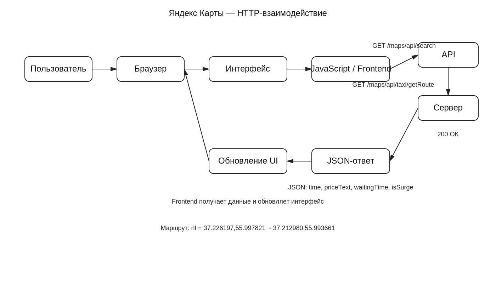

Лабораторная работа №2
Исследование взаимодействия компонентов веб-приложения на примере Яндекс Карт

Вариант 3 — Яндекс Карты

---

1. Исследуемая информационная система

В качестве исследуемой информационной системы используется веб-сервис Яндекс Карты.

Сервис предназначен для поиска объектов на карте, просмотра информации об организациях и построения маршрутов между различными точками.

Исследуемый пользовательский сценарий: поиск объекта на карте и выполнение операции маршрута.

Для анализа использовалась вкладка **Network** браузерных инструментов разработчика DevTools. С её помощью исследовались HTTP-запросы и ответы, параметры запросов, заголовки, cookies и взаимодействие frontend с API.

---

2. Анализ HTTP-запросов

2.1. Запрос поиска

Исследованный API endpoint:

`https://yandex.ru/maps/api/search`

| Параметр | Значение |
|---|---|
| Метод | GET |
| Статус | 200 OK |
| Тип ответа | `application/json; charset=utf-8` |
| Кодировка | gzip |
| Назначение | Получение данных, связанных с поиском/географическим объектом |

В запросе наблюдались параметры `ajax=1`, `lang=ru_RU`, `mode=uri`, `results=1`, `snippets`, `sessionId` и `csrfToken`.

Значения `sessionId` и `csrfToken` в отчёте не приводятся, поскольку относятся к служебным данным текущей сессии.

Запрос является GET-запросом. Параметры передаются в URL. Отдельное тело GET-запроса не наблюдалось.

  


2.2. Ответ поиска

Сервер вернул `200 OK` и JSON с типом `application/json; charset=utf-8`.

В ответе присутствовали идентификатор запроса, параметры поискового запроса, границы области поиска, количество результатов, список результатов, координаты, адрес, регион, географические идентификаторы и дополнительные сведения.

В исследованном ответе был получен объект типа `toponym`:

**«1-й микрорайон»**

Адрес: **Москва, Зеленоград, 1-й микрорайон**.

Координаты объекта:

`37.207545, 56.007931`

Это показывает, что API возвращает браузеру структурированные географические данные, которые frontend может использовать для отображения объекта.

  


---

3. Запрос маршрута

При выполнении операции, связанной с маршрутом, был обнаружен запрос:

`https://yandex.ru/maps/api/taxi/getRoute`

| Параметр | Значение |
|---|---|
| Метод | GET |
| Статус | 200 OK |
| Endpoint | `/maps/api/taxi/getRoute` |
| Формат ответа | JSON |
| Назначение | Получение информации о поездке/маршруте такси |

Основные параметры:

- `ajax=1`;
- `lang=ru_RU`;
- `rll`;
- `s`;
- `csrfToken`;
- `sessionId`.

Параметр `rll` содержит две пары координат:

`37.226197,55.997821~37.212980,55.993661`

Символ `~` разделяет две точки.

  

---

## 4. Ответ API маршрута

Сервер вернул `200 OK` и JSON:

```json
{
  "data": {
    "time": 727,
    "waitingTime": 7,
    "priceText": "242 ₽",
    "isSurge": true,
    "link": "//taxi.yandex.ru/order?..."
  }
}
```

| Поле | Значение | Назначение |
|---|---:|---|
| `time` | 727 | Расчётное время поездки |
| `waitingTime` | 7 | Время ожидания |
| `priceText` | 242 ₽ | Отображаемая стоимость |
| `isSurge` | true | Признак повышенного тарифа/спроса |
| `link` | ссылка | Ссылка для перехода к оформлению |

727 секунд — примерно 12 минут 7 секунд.

Ответ показывает, что сервер выполняет обработку переданных координат и возвращает рассчитанные параметры поездки.

  

---
5. Параметры и передаваемые данные

Географические данные

В запросе маршрута передаются две пары координат:

`37.226197,55.997821`

`37.212980,55.993661`

Они используются для задания двух точек операции.

Язык

`lang=ru_RU` указывает на русскоязычную локализацию.

Сессионные параметры

В запросах присутствуют `sessionId` и `csrfToken`. Это служебные параметры взаимодействия клиента с сервером.

AJAX

Параметр `ajax=1` указывает на запрос в контексте асинхронного взаимодействия веб-приложения.

---

6. Cookies

При работе с Яндекс Картами в браузере обнаружено большое количество cookies. Они используются для хранения служебной информации, идентификаторов, параметров сессии, настроек и аналитических данных.

Значения cookies в отчёте **не приводятся**.

| Cookie | Предполагаемое назначение |
|---|---|
| `_yasc` | Служебные данные сервисов Yandex |
| `_ym_uid` | Идентификатор пользователя в системе аналитики |
| `_ym_isad` | Параметры аналитики |
| `gdpr` | Информация, связанная с настройками GDPR |
| `is_gdpr` | Параметры применения GDPR |
| `maps_session_id` | Идентификатор сессии Яндекс Карт |
| `Session_id` | Сессионный идентификатор |
| `sessionid2` | Дополнительный сессионный идентификатор |
| `yandex_login` | Информация, связанная с авторизацией |
| `yandexuid` | Служебный идентификатор пользователя |
| `yandex_expboxes` | Параметры экспериментальных настроек |
| `yuidss` | Служебный идентификатор |
| `yclid_src` | Информация об источнике перехода |
| `yp` | Служебные и пользовательские параметры |
| `ys` | Настройки и параметры Yandex |

Назначение части cookies определено по названию и контексту использования, поэтому такие характеристики следует считать предположениями, а не непосредственно подтверждёнными фактами.

  

---

7. HTTP-заголовки

В исследованных ответах наблюдались:

- `Content-Type`;
- `Content-Encoding`;
- `ETag`;
- `Vary`;
- `X-Content-Type-Options`;
- `X-Req-Id`;
- `X-Trace-Id`;
- `X-Yandex-Req-Id`.

`Content-Type: application/json; charset=utf-8` показывает, что сервер возвращает структурированные данные JSON.

`Content-Encoding: gzip` означает, что данные могут передаваться в сжатом виде.

`ETag` используется как идентификатор версии ресурса и может применяться механизмами HTTP-кэширования.

`X-Content-Type-Options: nosniff` является защитным заголовком браузерной обработки типа содержимого.

`X-Req-Id`, `X-Trace-Id` и `X-Yandex-Req-Id` являются служебными идентификаторами, которые могут использоваться серверной инфраструктурой для отслеживания запросов.

  

---

8. Frontend, API и Backend

Наблюдение Network показывает, что клиентская часть Яндекс Карт взаимодействует с сервером через API.

Общая последовательность:

**Пользователь → интерфейс → JavaScript → HTTP GET → API → серверная обработка → JSON → JavaScript → интерфейс**

При выполнении действия пользователь взаимодействует с интерфейсом. Frontend обрабатывает действие и формирует HTTP-запрос. Браузер отправляет его API. Серверная часть выполняет необходимую обработку и возвращает JSON. Frontend получает ответ и обновляет интерфейс.

По данным Network нельзя достоверно определить конкретный язык программирования серверной части, СУБД или физическую структуру серверов. Поэтому эти характеристики не рассматриваются как установленные факты.

---

9. Сравнение с архитектурой лабораторной работы №1

В лабораторной работе №1 была рассмотрена общая архитектура:

**Пользователь → Браузер → Frontend → API → Сервер → Хранилище**

Лабораторная работа №2 позволяет уточнить её с точки зрения реального сетевого обмена.

| Компонент | Лабораторная №1 | Лабораторная №2 |
|---|---|---|
| Пользователь | Определён | Подтверждён сценарием |
| Браузер | Определён | Подтверждён DevTools |
| Frontend | Предположен | Подтверждается отправкой запросов |
| API | Определён | Подтверждён конкретными endpoints |
| HTTP | Рассматривался теоретически | Наблюдается непосредственно |
| Сервер | Предполагался | Подтверждается ответами API |
| JSON | Предполагался | Наблюдается непосредственно |
| Cookies | Рассматривались как часть системы | Наблюдаются непосредственно |
| Хранилище | Предположение | Тип непосредственно не установлен |

---

10. Подтверждённые факты и предположения

Непосредственно подтверждено

- браузер отправляет HTTP-запросы;
- используются GET-запросы;
- существуют endpoints `/maps/api/search` и `/maps/api/taxi/getRoute`;
- запросы получают статус `200 OK`;
- API возвращает JSON;
- запрос маршрута содержит координаты;
- ответ маршрута содержит время, стоимость и дополнительные параметры;
- браузер использует cookies;
- запросы содержат служебные параметры сессии;
- ответы содержат HTTP-заголовки.

Не подтверждено непосредственно

- конкретный язык программирования backend;
- конкретная СУБД;
- физическая структура серверов;
- внутренний алгоритм построения маршрута;
- точная реализация API;
- точное назначение части служебных cookies.

---

11. Диаграмма взаимодействия

На диаграмме показана последовательность взаимодействия компонентов веб-приложения:

**Пользователь → Браузер → Интерфейс → JavaScript/Frontend → API → Серверная обработка → JSON → Frontend → Интерфейс**

Для поиска указан endpoint:

`GET /maps/api/search`

Для маршрута:

`GET /maps/api/taxi/getRoute`

Для маршрута также показан параметр:

`rll = координаты двух точек`

и ответ:

`200 OK → JSON`

с данными о времени, стоимости, ожидании и повышенном тарифе.



Исходный файл диаграммы также приложен к работе в формате `.drawio`.

---

12. Итоговый пользовательский сценарий

1. Пользователь выполняет поиск объекта.
2. Интерфейс передаёт действие frontend-коду.
3. JavaScript формирует GET-запрос к `/maps/api/search`.
4. API получает параметры.
5. Сервер обрабатывает запрос.
6. Сервер возвращает JSON.
7. Frontend получает JSON.
8. Результат отображается на карте.
9. Пользователь задаёт маршрут/поездку.
10. Frontend формирует GET-запрос `/maps/api/taxi/getRoute`.
11. В запрос передаются координаты двух точек.
12. Сервер выполняет обработку.
13. API возвращает JSON.
14. Frontend обрабатывает ответ.
15. Полученная информация отображается пользователю.

---

13. Вывод

В ходе лабораторной работы было исследовано взаимодействие браузера с серверной частью веб-приложения Яндекс Карты.

С помощью DevTools Network были рассмотрены реальные HTTP-запросы и ответы, возникающие при выполнении пользовательского сценария.

Установлено, что клиентская часть взаимодействует с сервером через API. В исследованных случаях используется метод GET, а параметры передаются в URL.

Сервер возвращает ответы со статусом `200 OK` в формате JSON. Полученные данные содержат структурированную информацию о географических объектах и результатах операции маршрута.

Также были исследованы HTTP-заголовки и cookies. Cookies используются для хранения служебных данных, идентификаторов и параметров сессии. Их реальные значения в отчёте не приводятся.

По результатам работы была уточнена архитектура, рассмотренная в лабораторной работе №1. Если в первой работе взаимодействие компонентов рассматривалось на уровне общей архитектуры, то во второй работе непосредственно наблюдался сетевой обмен между браузером и API.

Итоговая последовательность взаимодействия:

**пользователь → frontend → HTTP-запрос → API → серверная обработка → HTTP-ответ → frontend → интерфейс.**
